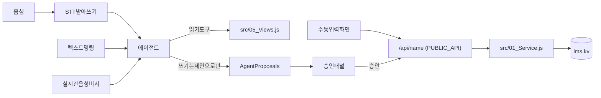

# 강사용 음성 AI 에이전트 로드맵

- 상태: 구상 (개발 일정 미정)
- 작성일: 2026-10-28

기존 수동 입력 화면은 그대로 두고, 같은 서비스 함수를 호출하는 "AI 제안 → 강사 승인" 레이어를 얹는다. 텍스트 명령 → 받아쓰기 음성 → 실시간 대화형 비서 순으로 확장한다.

## 범위

- 당분간 사용자는 나(강사 1명)뿐이다. 지금 구조(공유 비밀번호 하나, `lms.kv` 단일 저장소)를 그대로 쓴다.
- 사업화, 멀티테넌트, 법적 검토는 이 계획에 넣지 않는다. 맨 아래 "나중에" 섹션에 메모만 남긴다.

## 핵심 원칙

- **입력 경로는 둘, 저장 경로는 하나.** 수동 화면과 AI 모두 `src/01_Service.js`의 같은 함수(`saveTodaySession`, `saveHomeworkChecks`, `saveCounselingNote` 등)를 거쳐 저장한다. AI 전용 저장 로직은 만들지 않는다. 그래야 검증 규칙(레슨 중복 방지 등)과 데이터 형태가 항상 같다.
- **AI는 제안만 하고, 저장은 내가 승인할 때만 한다.** 현재 `lib/plan-ai.js`의 "초안 → 확인" 원칙을 모든 데이터로 넓힌다.
- **기존 스택을 유지한다.** Next.js 16, Supabase, `lib/ai-client.js`를 그대로 쓰고, 그 위에 tool calling과 스트리밍을 붙인다.

## 전체 구조

현재 저장 진입점(`app/api/[name]/route.js`)이 이미 `PUBLIC_API` 허용 목록 방식이라, 에이전트 도구를 그 위에 그대로 만들 수 있다.

## 단계별 계획

### 0단계: 기반 (음성 없이)

- **도구 목록 정의:** 새 파일 `lib/agent-tools.js`에 `PUBLIC_API` 중 에이전트가 쓸 함수만 골라 한국어 설명과 인자 스키마를 붙인다.
  - 읽기 도구: 학생 검색, 오늘 수업, 반 명단, 최근 레슨
  - 쓰기 도구: 출결·점수·숙제·특이사항, 상담 기록, 할 일, 보강
- **제안 테이블:** `LMS.TABLES`(`src/00_Core.js`)에 `AgentProposals`를 추가한다.
  - 필드: `proposal_id`, `source`(text/dictation/realtime), `transcript`, `calls`(`[{name, args}]`), `summary`, `status`(pending/applied/rejected), `created_at`
  - 승인하면 기존 `apiBatch`로 한 트랜잭션 안에서 실행한다.
- **문맥 구성기:** 오늘 수업, 반 명단, 동명이인 정보를 짧게 묶어 AI에 넘긴다.
  - 학생 이름 해석이 가장 어렵다: 성 생략, 별명, 동명이인을 구분해야 한다.
  - 확신이 낮으면 추측하지 않고 "어느 학생인지" 되묻는다.
- **평가 세트:** `tests/`에 실제 발화 예시와 기대하는 도구 호출 쌍을 30~50개 만들어 회귀 테스트로 쓴다.

### 1단계: 텍스트 명령 → 제안

- 전역 입력창(`components/shell/GlobalSearch.js` 옆)에 "AI에게 말하기"를 추가한다.
  - 예: "중2A반 민수 결석, 지우 숙제 절반, 시험 85점"
- 새 라우트 `app/api/agent/route.js`를 만든다.
  - 에이전트가 도구를 호출해 제안을 만든다.
  - AI 호출은 DB 잠금 밖에서 한다. `generateMonthlyReportAi`와 같은 패턴이다.
- 승인 패널: 바뀌는 내용을 기존 값과 나란히 보여준다. 항목별로 체크하고 수정한 뒤 승인할 수 있다.
- 이 단계에서 음성 없이 파이프라인 전체를 검증한다.

### 2단계: 받아쓰기 음성 (수업 후 정리)

- 브라우저 `MediaRecorder`로 녹음해 STT 결과를 1단계 파이프라인에 넣는다.
- STT 후보(한국어 품질 기준으로 비교): OpenAI `gpt-4o-transcribe`, Deepgram, 네이버 CLOVA Speech
- 긴 녹음 처리: Vercel 60초 제한 때문에 녹음을 Blob에 올리고 백그라운드로 처리한다. 제안이 준비되면 알림을 띄운다.
- 진입점: `components/domain/today/LessonRecorder.js`, 학생 상세 상담 탭에 마이크 버튼
- 모바일 PWA 대응: 수업 직후 휴대폰으로 녹음하는 상황을 고려한다.

### 3단계: 조회형 에이전트

- 읽기 도구만으로 질문에 답한다.
  - 예: "이번 주 숙제 두 번 이상 안 한 학생?", "민수 최근 상담 내용"
- 답변 안의 학생과 반은 상세 페이지 링크로 보여준다.

### 4단계: 실시간 대화형 비서 (Muse/Manus 스타일)

- OpenAI Realtime API(WebRTC)를 쓴다. 서버에서 단기 토큰을 발급하고, 브라우저가 직접 연결한다.
- 대화 중 쓰기 요청은 즉시 저장하지 않고 제안 대기열에 쌓는다. 대화가 끝나면 한 번에 승인한다.
- 누르고 말하기(push-to-talk)를 기본으로 해서 수업 중 오작동을 막는다.

### 5단계: 능동형 기능

- 아침 브리핑: 오늘 수업, 보강, 후속 상담 할 일
- 월말 리포트 초안 자동 대기열 (`generateMonthlyReportsBulk` 재사용)
- 반복 패턴 알림: 연속 결석, 숙제 미이행 등

## 구현 전에 정할 것

- **STT 공급자:** 내 목소리와 교실 소음 환경에서 2~3개를 직접 비교해 고른다.
- **모델:** 현재 기본값 `openrouter/free`는 tool calling 품질이 부족할 가능성이 높다. 유료 모델을 쓸지 정하고, 월 사용 비용을 단계별로 확인한다.
- **녹음 원본:** 텍스트로 변환한 뒤 원본을 지울지 보관할지 정한다. 개인 사용이라도 학생 이름이 담기니 기본은 삭제를 권장한다.
- **성능:** `withService`는 전역 잠금 아래 전체 테이블을 불러온다. 1인 사용에는 문제없지만, 4단계 실시간 비서의 잦은 읽기는 가벼운 읽기 경로를 검토한다.

## 나중에 (지금은 하지 않음)

- 프리랜서 강사 대상 사업화: 강사 개인 계정, `lms.kv` 강사별 분리, `Workplaces`(근무처) 테이블
  - 제품 정체성은 학원관리 프로그램이 아니라 강사 개인의 수업 비서. 데이터 구조는 강사 → 근무처(학원, 과외) → 반 → 학생.
- 개인정보·법적 검토: 강사가 학생 정보를 보관하는 문제, 외부 AI 전송 범위, 녹음 동의
- 가격(받아쓰기 기본 요금제, 실시간 비서 상위 요금제)과 유통 경로(강사 커뮤니티, 지인 추천)
- 저장은 모두 `withService`를 거치므로, 나중에 강사별 분리를 할 때 에이전트 코드는 크게 바꿀 필요가 없다.
