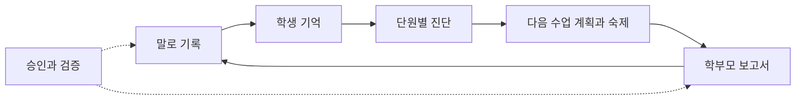
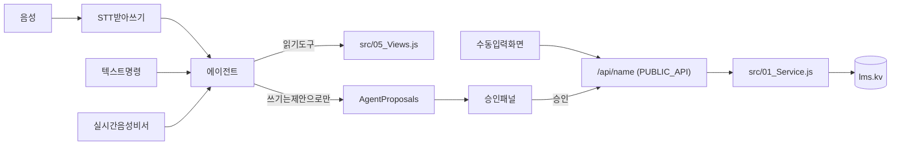

# 강사용 음성 AI 에이전트 로드맵

- 상태: 채팅 AI 비서 1차 구현 완료(음성 없음). 단계를 가치 순서(A~F)로 개정 — 2026-11-03
- 작성일: 2026-10-28

기존 수동 입력 화면은 그대로 두고, 같은 서비스 함수를 호출하는 "AI 제안 → 강사 승인" 레이어를 얹는다. 단계는 기술 순서가 아니라 강사에게 주는 가치 순서(기록 → 기억 → 진단 → 능동 알림)로 확장한다.

## 제품 정체성과 차별화

학원관리 프로그램과 같은 기준으로 경쟁하지 않는다. 기존 학원관리 프로그램은 원장을 위한 도구다. 출결, 수납, 문자 발송이 중심이고, 데이터는 학원 소유이며 강사는 입력하는 사람이다. 이 프로젝트는 **강사 개인 수업 비서**로 자리 잡는다.

### 포지셔닝 요약

- **기준 고객:** 학원 2곳 이상, 또는 학원과 과외를 함께 하는 프리랜서 수학 강사. 직접 보고서를 쓰고 학부모와 소통하는 사람.
- **시장 카테고리:** 학원관리 프로그램의 하위 카테고리인 "강사용 AI 수업 비서". 완전히 새로운 카테고리는 시장에 설명하는 비용이 커서 피한다.
- **경쟁 대안 (이 제품이 없으면 강사가 쓰는 것):** 학원이 정해 준 관리 프로그램, 엑셀·메모앱·카카오톡 조합, 머릿속 기억, ChatGPT에 학생 정보를 복사해 붙여넣기.
- **우리만 가진 것:**
  - 승인형 AI: 제안 → 강사 승인 → 저장 후 다시 읽어 검증 → 실패하면 되돌림
  - 수업 기록 → 보고서 → 다음 달 강의 계획이 하나로 이어지는 구조
  - 학생별 학습 신호: 숙제 항목별 A–F 등급, 시험 범위, 진도
  - 시험대비 반 편성
- **가치 3가지:**
  1. 수업 직후 정리를 몇 분 안에 끝낸다.
  2. 학생 한 명 한 명을 기억하고 챙기는 강사로 보이게 한다. 학부모와 원장의 신뢰로 이어진다.
  3. 근무처가 바뀌어도 내 학생 기록과 수업 노하우가 남는다.

### 강사가 해결하려는 일

"수업이 끝나고 지친 상태에서 기억이 흐려지기 전에 학생별 관찰을 남기고, 학부모에게 보낼 보고서까지 끝내서, 퇴근 뒤 잡무 없이 다음 수업을 준비하고 싶다."

- 감정 측면: 놓친 학생이 없다는 안심
- 사회적 측면: 꼼꼼한 강사로 보이고 싶음
- 바꾸지 못하게 막는 힘: 입력이 귀찮음, AI가 틀릴까 하는 불안, 학원마다 다른 도구를 이미 쓰고 있다는 습관

### 차별화 축 다섯 가지

1. **입력이 거의 필요 없는 기록:** 수업 직후 휴대폰에 말하면 출결, 점수, 숙제, 특이사항 제안이 만들어진다. 실시간 대화보다 받아쓰기가 먼저다.
2. **강사의 기억:** 몇 년, 여러 근무처에 걸친 학생별 맥락을 기억한다. "지난 시험 직전에도 이 단원에서 막혔다" 같은 말을 해 주는 것이 기존 프로그램과의 가장 큰 차이다.
3. **기록에서 끝나지 않는 흐름:** 시험 범위와 점수, 숙제 등급을 단원 단위로 묶어 약한 단원을 찾고, 클리닉·보충 숙제·다음 수업 계획까지 제안한다. 기존 프로그램은 기록에서 멈춘다.
4. **믿을 수 있는 AI:** 승인, 검증, 되돌림, 변경 기록이 있다. 학부모 문구는 강사가 고친 내용을 보고 강사의 말투를 따라간다.
5. **근무처를 가로지르는 구조:** 강사 → 근무처 → 반 → 학생 구조다. 지금 구현하지는 않지만 아래 "지금부터 지킬 설계 제약"을 따른다.

## 범위

- 당분간 사용자는 나(강사 1명)뿐이다. 지금 구조(공유 비밀번호 하나, `lms.kv` 단일 저장소)를 그대로 쓴다.
- 사업화, 멀티테넌트, 법적 검토는 이 계획에 넣지 않는다. 위 정체성은 설계 방향을 정하는 기준으로만 쓰고, 사업화 관련 일은 맨 아래 "나중에" 섹션에 메모만 남긴다.

## 핵심 원칙

- **입력 경로는 둘, 저장 경로는 하나.** 수동 화면과 AI 모두 `src/01_Service.js`의 같은 함수(`saveTodaySession`, `saveHomeworkChecks`, `saveCounselingNote` 등)를 거쳐 저장한다. AI 전용 저장 로직은 만들지 않는다. 그래야 검증 규칙(레슨 중복 방지 등)과 데이터 형태가 항상 같다.
- **AI는 제안만 하고, 저장은 내가 승인할 때만 한다.** 현재 `lib/plan-ai.js`의 "초안 → 확인" 원칙을 모든 데이터로 넓힌다.
- **기존 스택을 유지한다.** Next.js 16, Supabase, `lib/ai-client.js`를 그대로 쓰고, 그 위에 tool calling과 스트리밍을 붙인다.

## 지금부터 지킬 설계 제약

- **근무처 구조를 막지 않는다.** 나중에 강사 → 근무처(학원, 과외) → 반 → 학생 구조로 갈 수 있게 한다. 학원이 하나만 있다고 가정하는 부분(예: 설정의 `academy_name` 하나)을 더 늘리지 않는다. 새 설정이나 필드가 학원 단위라면 반이나 근무처에 붙일 수 있는 형태로 둔다.
- **녹음 원본은 기본으로 지운다.** 텍스트로 변환한 뒤 원본은 남기지 않는 것을 기본값으로 한다.

## 전체 구조

현재 저장 진입점(`app/api/[name]/route.js`)이 이미 `PUBLIC_API` 허용 목록 방식이라, 에이전트 도구를 그 위에 그대로 만들 수 있다.

## 단계별 계획

### 진행 상황 (2026-11-03 기준)

- 구현(2026-10-31): 전역 채팅 패널(`components/shell/AgentPanel.js`, `Ctrl+J`), `/api/agent` 도구 호출 루프(`lib/agent.js`), 도구 목록(`lib/agent-tools.js`: 조회 10개, 승인형 쓰기 3개), 대화·제안 테이블과 승인·검증(`src/07_Agent.js`), 승인 라우트 `/api/agent/apply`, 테스트(`tests/agent.test.js`).
- 처음 계획과 다른 점: 쓰기는 제안 카드 단위로 한꺼번에 승인한다(항목별 체크·수정은 아직 없음). 승인은 실패 기록을 위해 `/api/[name]` 대신 전용 라우트를 쓴다.
- 모델: AI 비서는 `ANTHROPIC_API_KEY`로 Claude Haiku 5.5를 쓴다. 학생 이름 해석 실패가 잦으면 Sonnet 5.5로 올린다. 월말 보고서와 강의 계획은 계속 OpenRouter를 쓴다.
- 처음 계획의 0·1·3단계(기반, 텍스트 명령 → 제안, 조회형)는 1차 구현이 끝났다. 남은 일은 아래 A~F 단계로 다시 나눴다.
  - A: 성적 입력·진도 저장 도구, 제안 항목별 선택·수정, 발화 평가 세트(30~50개)
  - B: 받아쓰기 음성(처음 계획의 2단계)
  - C~E: 학생 기억, 진단과 제안, 능동형 기능(처음 계획의 5단계를 앞으로 당김)
  - F: 실시간 대화형 비서(처음 계획의 4단계를 맨 뒤로 내림)

### 이미 갖춘 기반

- **도구 목록:** `lib/agent-tools.js`에 `PUBLIC_API` 중 에이전트가 쓸 함수만 골라 한국어 설명과 인자 스키마를 붙였다.
- **제안 테이블:** `AgentProposals`에 `proposal_id`, `source`(text/dictation/realtime), `transcript`, `calls`(`[{name, args}]`), `summary`, `status`(pending/applied/rejected), `created_at`을 둔다. 승인하면 한 트랜잭션 안에서 실행하고, 저장 후 다시 읽어 검증한다.
- **문맥 구성기:** 오늘 수업, 반 명단, 동명이인 정보를 짧게 묶어 AI에 넘긴다. 확신이 낮으면 추측하지 않고 "어느 학생인지" 되묻는다.
- **AI 호출 위치:** AI 호출은 DB 잠금 밖에서 한다. `generateMonthlyReportAi`와 같은 패턴이다.

### A. 기록 완성 (음성 전)

- **성적·진도 쓰기 도구:** 성적 입력과 진도 저장(`saveTodaySession`) 도구를 추가한다. 가장 자주 쓰는 쓰기라서, 이것이 없으면 받아쓰기의 가치가 절반으로 떨어진다.
- **항목별 승인·수정:** 승인 패널에서 바뀌는 내용을 기존 값과 나란히 보여주고, 항목별로 체크하고 수정한 뒤 승인할 수 있게 한다. 받아쓰기는 오류가 잦아서 카드 통째 승인으로는 부족하다.
- **평가 세트:** `tests/`에 실제 발화 예시와 기대하는 도구 호출 쌍을 30~50개 만들어 회귀 테스트로 쓴다.
  - 학생 이름 해석이 핵심이다: 성 생략, 별명, 동명이인을 구분해야 한다.
- **다음 단계로 가는 조건:** 평가 세트를 통과해야 B단계(음성)로 넘어간다.

### B. 수업 직후 받아쓰기

- 휴대폰 PWA에서 누르고 말하기(push-to-talk)로 녹음한다. 수업 직후 휴대폰으로 녹음하는 상황이 기본이다.
- 브라우저 `MediaRecorder`로 녹음해 STT 결과를 기존 텍스트 파이프라인에 넣는다.
- STT 공급자 비교: OpenAI `gpt-4o-transcribe`, Deepgram, 네이버 CLOVA Speech를 내 목소리와 교실 소음 환경에서 직접 비교해 고른다.
- 긴 녹음 처리: Vercel 함수 기본 제한은 300초다. 녹음 길이와 처리 시간이 이를 넘을 수 있으면 녹음을 Blob에 올리고 백그라운드로 처리한다. 제안이 준비되면 알림을 띄운다.
- 녹음 원본은 텍스트로 변환한 뒤 지우는 것을 기본값으로 한다.
- 진입점: `components/domain/today/LessonRecorder.js`, 학생 상세 상담 탭에 마이크 버튼

### C. 학생 기억과 조회

- 읽기 도구만으로 질문에 답한다(1차 구현됨).
  - 예: "이번 주 숙제 두 번 이상 안 한 학생?", "민수 최근 상담 내용"
- 답변 안의 학생과 반은 상세 페이지 링크로 보여준다.
- 학생별 장기 맥락 요약을 더한다. 여러 달의 레슨, 상담, 시험 기록을 짧게 묶어 "지난 시험 직전에도 이 단원에서 막혔다" 같은 답을 할 수 있게 한다.

### D. 진단과 제안

- 시험 범위와 점수, 숙제 항목별 등급, 진도를 단원 단위로 묶어 약한 단원을 찾는다.
- 클리닉, 보충 숙제, 다음 수업 계획을 제안한다. 저장은 다른 쓰기와 같이 승인할 때만 한다.
- 기존 `src/06_Plans.js`의 학생 신호를 재사용한다. 새 분석 로직을 따로 만들지 않는다.

### E. 능동형 기능

- 아침 브리핑: 오늘 수업, 보강, 후속 상담 할 일
- 반복 패턴 알림: 연속 결석, 숙제 미이행 등
- 월말 보고서 초안 자동 대기열 (`generateMonthlyReportsBulk` 재사용)
- 조회 도구만으로 만들 수 있어 비용이 낮고 차별화 효과가 크다.

### F. 실시간 대화형 비서 (선택)

- 선택 사항이다. 비용이 크고 교실에서 오작동 위험이 있으며, 프리랜서 강사 문제의 중심도 아니다.
- 하게 되면 OpenAI Realtime API(WebRTC)를 쓴다. 서버에서 단기 토큰을 발급하고, 브라우저가 직접 연결한다.
- 대화 중 쓰기 요청은 즉시 저장하지 않고 제안 대기열에 쌓는다. 대화가 끝나면 한 번에 승인한다.
- 누르고 말하기를 기본으로 해서 수업 중 오작동을 막는다.

## 성공 지표

- 수업 1회 정리에 걸리는 시간
- AI 제안을 그대로 승인한 비율과 고친 비율
- 학생 이름 해석 정확도 (평가 세트와 실제 사용 모두)
- 월말 보고서 작성 시간

## 검증 (강사 인터뷰)

- 사업화 전에 프리랜서 강사 5~10명을 인터뷰한다.
- "이런 기능이 있으면 쓰겠느냐"가 아니라 "지난번 수업 끝나고 실제로 어떻게 정리했느냐"를 묻는다.
- 확인할 것: 경쟁 대안(지금 쓰는 도구와 방법), 바꾸지 못하게 막는 힘(입력 귀찮음, AI 불안, 기존 도구 습관).
- 개인정보 처리를 판매 포인트로 쓸 수 있는지 본다: 학생 이름 별칭 처리, 녹음 원본 삭제.

## 남은 결정과 주의점

- **STT 공급자:** B단계에서 2~3개를 직접 비교해 고른다.
- **모델:** 결정 완료. AI 비서는 Claude Haiku 5.5(`ANTHROPIC_API_KEY`), 이름 해석 실패가 잦으면 Sonnet 5.5. 월 사용 비용은 단계별로 확인한다.
- **녹음 원본:** 기본은 삭제다(설계 제약 참고).
- **성능:** `withService`는 전역 잠금 아래 전체 테이블을 불러온다. 1인 사용에는 문제없지만, E단계 알림이나 F단계 실시간 비서의 잦은 읽기는 가벼운 읽기 경로를 검토한다.

## 나중에 (지금은 하지 않음)

- 프리랜서 강사 대상 사업화: 강사 개인 계정, `lms.kv` 강사별 분리, `Workplaces`(근무처) 테이블
  - 데이터 구조는 강사 → 근무처(학원, 과외) → 반 → 학생. 지금은 위 설계 제약만 지킨다.
- 개인정보·법적 검토: 강사가 학생 정보를 보관하는 문제, 외부 AI 전송 범위, 녹음 동의
- 가격(받아쓰기 기본 요금제, 실시간 비서 상위 요금제)과 유통 경로(강사 커뮤니티, 지인 추천)
- 저장은 모두 `withService`를 거치므로, 나중에 강사별 분리를 할 때 에이전트 코드는 크게 바꿀 필요가 없다.
