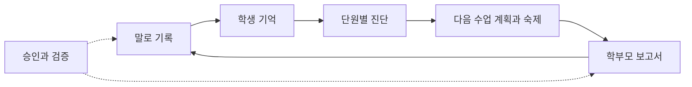
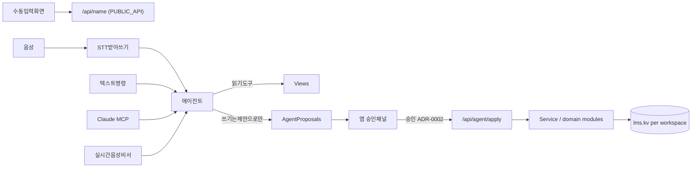

# 강사용 음성 AI 에이전트 로드맵

- 상태: 채팅 AI 비서·MCP 커넥터 운영 중(음성 없음). A~F 가치 순서 유지. **현실 동기화 2026-11-19**
- 작성일: 2026-10-28
- 다음 실행: [phase-a-next.md](./phase-a-next.md) (Phase A 작업 패키지·종료 조건·첫 PR)

기존 수동 입력 화면은 그대로 두고, 같은 서비스 함수를 호출하는 "AI 제안 → 강사 승인" 레이어를 얹는다. 단계는 기술 순서가 아니라 강사에게 주는 가치 순서(기록 → 기억 → 진단 → 능동 알림)로 확장한다.

## 제품 정체성과 차별화

학원관리 프로그램과 같은 기준으로 경쟁하지 않는다. 기존 학원관리 프로그램은 원장을 위한 도구다. 출결, 수납, 문자 발송이 중심이고, 데이터는 학원 소유이며 강사는 입력하는 사람이다. 이 프로젝트는 **강사 개인 수업 비서**로 자리 잡는다.

### 포지셔닝 요약

- **기준 고객:** 학원 2곳 이상, 또는 학원과 과외를 함께 하는 프리랜서 수학 강사. 직접 보고서를 쓰고 학부모와 소통하는 사람.
- **시장 카테고리:** 학원관리 프로그램의 하위 카테고리인 "강사용 AI 수업 비서". 완전히 새로운 카테고리는 시장에 설명하는 비용이 커서 피한다.
- **경쟁 대안 (이 제품이 없으면 강사가 쓰는 것):** 학원이 정해 준 관리 프로그램, 엑셀·메모앱·카카오톡 조합, 머릿속 기억, ChatGPT에 학생 정보를 복사해 붙여넣기.
- **우리만 가진 것:**
  - 승인형 AI: 제안 → 강사 승인 → 저장 후 다시 읽어 검증 → 실패하면 되돌림
  - 수업 기록 → 보고서 → 다음 달 강의 계획이 하나로 이어지는 구조
  - 학생별 학습 신호: 숙제 항목별 A–F 등급, 시험 범위, 진도
  - 시험대비 반 편성
- **가치 3가지:**
  1. 수업 직후 정리를 몇 분 안에 끝낸다.
  2. 학생 한 명 한 명을 기억하고 챙기는 강사로 보이게 한다. 학부모와 원장의 신뢰로 이어진다.
  3. 근무처가 바뀌어도 내 학생 기록과 수업 노하우가 남는다.

### 강사가 해결하려는 일

"수업이 끝나고 지친 상태에서 기억이 흐려지기 전에 학생별 관찰을 남기고, 학부모에게 보낼 보고서까지 끝내서, 퇴근 뒤 잡무 없이 다음 수업을 준비하고 싶다."

- 감정 측면: 놓친 학생이 없다는 안심
- 사회적 측면: 꼼꼼한 강사로 보이고 싶음
- 바꾸지 못하게 막는 힘: 입력이 귀찮음, AI가 틀릴까 하는 불안, 학원마다 다른 도구를 이미 쓰고 있다는 습관

### 차별화 축 다섯 가지

1. **입력이 거의 필요 없는 기록:** 수업 직후 휴대폰에 말하면 출결, 점수, 숙제, 특이사항 제안이 만들어진다. 실시간 대화보다 받아쓰기가 먼저다.
2. **강사의 기억:** 몇 년, 여러 근무처에 걸친 학생별 맥락을 기억한다. "지난 시험 직전에도 이 단원에서 막혔다" 같은 말을 해 주는 것이 기존 프로그램과의 가장 큰 차이다.
3. **기록에서 끝나지 않는 흐름:** 시험 범위와 점수, 숙제 등급을 단원 단위로 묶어 약한 단원을 찾고, 클리닉·보충 숙제·다음 수업 계획까지 제안한다. 기존 프로그램은 기록에서 멈춘다.
4. **믿을 수 있는 AI:** 승인, 검증, 되돌림, 변경 기록이 있다. 학부모 문구는 강사가 고친 내용을 보고 강사의 말투를 따라간다.
5. **근무처를 가로지르는 구조:** 강사 → 근무처 → 반 → 학생 구조다. 지금 구현하지는 않지만 아래 "지금부터 지킬 설계 제약"을 따른다.

## 범위

- **우선 사용자는 본인(강사) dogfooding이다.** 기능·우선순위는 여전히 본인 수업 흐름에 맞춘다.
- **계정·작업공간은 이미 있다.** 공유 비밀번호 하나 + 단일 `lms.kv`만 쓰던 시절은 지났다. 강사 로그인, 초대, 워크스페이스별 `lms.kv` 분리가 동작한다(README·accounts 마이그레이션). 다만 사업화·멀티테넌트 제품화·법적 검토는 이 로드맵에 넣지 않는다.
- 위 정체성은 설계 방향을 정하는 기준으로만 쓰고, 사업화 관련 일은 맨 아래 "나중에" 섹션에 메모만 남긴다.

## 핵심 원칙

- **입력 경로는 둘, 저장 경로는 하나.** 수동 화면과 AI 모두 `src/01_Service.js`(및 분리된 도메인 모듈)의 같은 함수를 거쳐 저장한다. AI 전용 저장 로직은 만들지 않는다.
- **AI는 제안만 하고, 저장은 앱에서 강사가 승인할 때만 한다.** ADR-0002: 승인·거절은 앱 세션만. MCP/Claude는 제안 생성·대기 목록 조회만 한다.
- **기존 스택을 유지한다.** Next.js, Supabase, `lib/ai-client.js`를 그대로 쓰고, tool calling과 스트리밍을 붙인다.

## 지금부터 지킬 설계 제약

- **근무처 구조를 막지 않는다.** 나중에 강사 → 근무처(학원, 과외) → 반 → 학생 구조로 갈 수 있게 한다. 학원이 하나만 있다고 가정하는 부분(예: 설정의 `academy_name` 하나)을 더 늘리지 않는다.
- **녹음 원본은 기본으로 지운다.** 텍스트로 변환한 뒤 원본은 남기지 않는 것을 기본값으로 한다.

## 전체 구조

## 현재 현실 (2026-11-19)

### 인앱 AI 비서

- 전역 패널 `components/shell/AgentPanel.js` (`Ctrl+J`), `/api/agent` 도구 루프(`lib/agent.js`).
- **읽기 10 + 쓰기 6** (`lib/agent-tools.js` → `assistant` surface):
  - 읽기: `search_students`, `get_student_profile`, `get_attendance`, `get_student_lessons`, `get_scores`, `get_homework_status`, `get_counseling_notes`, `get_today_board`, `list_classes`, `get_class_members`
  - 쓰기(승인형): `update_attendance`, `save_lesson`, `update_lesson`, `save_class_session`, `create_counseling`, `update_task_status`
- 제안 카드(`ProposalCard`): call 단위 체크 + **승인 전 인자 인라인 편집**(`overrides` → apply 직전 re-preview).
- 승인 대기함(Inbox): 대화·MCP에서 올라온 pending을 일괄 선택·반영/거절.

### Claude MCP 커넥터

- 도구 약 **84개** (`AGENT_TOOLS` 기준, MCP surface: 읽기 ~35 + 쓰기 ~49). 수업 기록·진도·숙제·반·시험 등 넓은 write action이 `src/agent-actions/*`에 이미 있고, 기본 surface는 MCP다.
- 쓰기 모드: `read_only` | `proposal`만. `claude_approve`는 제거·레거시 정규화(ADR-0002).

### 승인·계정

- **ADR-0002 (채택):** 제안 apply/reject는 앱 로그인 세션만. MCP는 승인 도구 없음.
- **강사 계정·워크스페이스:** 로그인, 초대, 워크스페이스별 저장이 있다. dogfooding 우선은 유지하되, "공유 비밀번호 하나" 전제는 더 이상 맞지 않는다.

### 테스트

- `tests/agent.test.js`, `tests/agent-actions.test.js`, `tests/agent-action-registry.test.js` 등.
- **발화 평가 세트:** `tests/agent-eval/` (~40 한국어 지시) + `tests/agent-eval.test.js` CI 게이트(모델 호출 없음). B 진입 조건.

## 단계별 계획

### 진행 상황 요약

| 단계 | 상태 | 메모 |
|------|------|------|
| A 기록 완성 | **완료(A1–A3)** | 인앱 수업 쓰기 6, 승인 전 편집, eval 게이트. MCP write 전량 복제는 안 함 |
| B 받아쓰기 | 미착수 | A 평가 세트 통과 후 |
| C 학생 기억 | 부분 | 조회 도구는 있음. 장기 맥락 요약은 미착수 |
| D 진단·제안 | 미착수 | `06_Plans` 신호 재사용 예정 |
| E 능동형 | 미착수 | 브리핑·패턴 알림 |
| F 실시간 | 보류 | 선택·맨 뒤 |

### A. 기록 완성 (음성 전) — 완료 vs 미완

**된 것**

- 텍스트 명령 → 제안 → 앱 승인 파이프라인
- 인앱 읽기 10 + 쓰기 6, MCP 광역 도구(~84)
- ProposalCard **항목(call)별 체크 선택** 반영
- ADR-0002 앱 전용 승인
- 계정·워크스페이스

**Phase A 완료 (A1–A3)**

1. 인앱 수업 기록 쓰기: `save_lesson` / `update_lesson` / `save_class_session` (+ 기존 출결·상담·할 일) → 쓰기 6.
2. 승인 전 편집: ProposalCard inline edit + apply `overrides` re-preview.
3. 평가 세트: `tests/agent-eval/` ~40 + CI 게이트.
4. **B 진입:** eval 회귀 통과 후 받아쓰기(B).

상세 작업 패키지·키 파일·하지 말 것 → [phase-a-next.md](./phase-a-next.md).

### B. 수업 직후 받아쓰기

- 휴대폰 PWA에서 누르고 말하기(push-to-talk)로 녹음한다. 수업 직후 휴대폰으로 녹음하는 상황이 기본이다.
- 브라우저 `MediaRecorder`로 녹음해 STT 결과를 기존 텍스트 파이프라인에 넣는다.
- STT 공급자 비교: OpenAI `gpt-4o-transcribe`, Deepgram, 네이버 CLOVA Speech를 내 목소리와 교실 소음 환경에서 직접 비교해 고른다.
- 긴 녹음 처리: Vercel 함수 기본 제한은 300초다. 녹음 길이와 처리 시간이 이를 넘을 수 있으면 녹음을 Blob에 올리고 백그라운드로 처리한다. 제안이 준비되면 알림을 띄운다.
- 녹음 원본은 텍스트로 변환한 뒤 지우는 것을 기본값으로 한다.
- 진입점: `components/domain/today/LessonRecorder.js`, 학생 상세 상담 탭에 마이크 버튼

### C. 학생 기억과 조회

- 읽기 도구만으로 질문에 답한다(1차·MCP 확장 구현됨).
  - 예: "이번 주 숙제 두 번 이상 안 한 학생?", "민수 최근 상담 내용"
- 답변 안의 학생과 반은 상세 페이지 링크로 보여준다.
- 학생별 장기 맥락 요약을 더한다. 여러 달의 레슨, 상담, 시험 기록을 짧게 묶어 "지난 시험 직전에도 이 단원에서 막혔다" 같은 답을 할 수 있게 한다.

### D. 진단과 제안

- 시험 범위와 점수, 숙제 항목별 등급, 진도를 단원 단위로 묶어 약한 단원을 찾는다.
- 클리닉, 보충 숙제, 다음 수업 계획을 제안한다. 저장은 다른 쓰기와 같이 승인할 때만 한다.
- 기존 `src/06_Plans.js`의 학생 신호를 재사용한다. 새 분석 로직을 따로 만들지 않는다.

### E. 능동형 기능

- 아침 브리핑: 오늘 수업, 보강, 후속 상담 할 일
- 반복 패턴 알림: 연속 결석, 숙제 미이행 등
- 월말 보고서 초안 자동 대기열 (`generateMonthlyReportsBulk` 재사용)
- 조회 도구만으로 만들 수 있어 비용이 낮고 차별화 효과가 크다.

### F. 실시간 대화형 비서 (선택)

- 선택 사항이다. 비용이 크고 교실에서 오작동 위험이 있으며, 프리랜서 강사 문제의 중심도 아니다.
- 하게 되면 OpenAI Realtime API(WebRTC)를 쓴다. 서버에서 단기 토큰을 발급하고, 브라우저가 직접 연결한다.
- 대화 중 쓰기 요청은 즉시 저장하지 않고 제안 대기열에 쌓는다. 대화가 끝나면 한 번에 승인한다.
- 누르고 말하기를 기본으로 해서 수업 중 오작동을 막는다.

## 성공 지표

- 수업 1회 정리에 걸리는 시간
- AI 제안을 그대로 승인한 비율과 고친 비율
- 학생 이름 해석 정확도 (평가 세트와 실제 사용 모두)
- 월말 보고서 작성 시간

## 검증 (강사 인터뷰)

- 사업화 전에 프리랜서 강사 5~10명을 인터뷰한다.
- "이런 기능이 있으면 쓰겠느냐"가 아니라 "지난번 수업 끝나고 실제로 어떻게 정리했느냐"를 묻는다.
- 확인할 것: 경쟁 대안(지금 쓰는 도구와 방법), 바꾸지 못하게 막는 힘(입력 귀찮음, AI 불안, 기존 도구 습관).
- 개인정보 처리를 판매 포인트로 쓸 수 있는지 본다: 학생 이름 별칭 처리, 녹음 원본 삭제.

## 남은 결정과 주의점

- **STT 공급자:** B단계에서 2~3개를 직접 비교해 고른다.
- **모델:** AI 비서는 Claude(Haiku 계열, `ANTHROPIC_API_KEY`). 이름 해석 실패가 잦으면 상위 모델. 월말 보고서·강의 계획은 OpenRouter 경로를 유지한다.
- **녹음 원본:** 기본은 삭제다(설계 제약 참고).
- **성능:** `withService`는 워크스페이스 잠금 아래 테이블을 불러온다. 1인 dogfooding에는 문제없지만, E단계 알림이나 F단계 실시간 비서의 잦은 읽기는 가벼운 읽기 경로를 검토한다.
- **인앱 vs MCP 도구 폭:** MCP write가 넓고 인앱은 의도적으로 좁다. Phase A에서 수업 직후 기록에 필요한 것만 인앱에 연다. 전부 복제하지 않는다.

## 나중에 (지금은 하지 않음)

- 프리랜서 강사 대상 **상업화** 포장: 요금제, 유통, 마케팅 사이트
- `Workplaces`(근무처) 테이블을 제품 기능으로 노출 — 설계 제약만 지킨다
- 개인정보·법적 검토: 강사가 학생 정보를 보관하는 문제, 외부 AI 전송 범위, 녹음 동의
- F 실시간 비서, Claude 쪽 승인 재개방(ADR-0002를 먼저 재검토)
- 저장은 서비스/도메인 경로를 거치므로, 워크스페이스 분리가 되어 있어도 에이전트 코드는 surface·승인 규칙만 지키면 된다.
